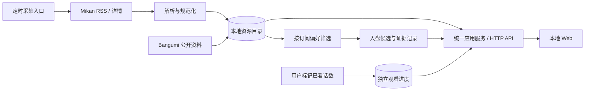

# 本地个人使用的演进路线

更新时间：2026-10-30。状态：设计建议，尚未实施。

用户目前需要本地个人使用，希望减少到境外蜜柑网站找资源的操作，并记录看番进度。前后端分开部署是未来可能性，本轮只记录方向，不调整技术栈、数据库、调度任务或运行数据。

## 1. 建议保留 Python，优先完善数据层

目前主要工作是网络读取、资源解析、筛选和本地查询，未观察到需要通过换语言解决的性能问题。基于现有代码与测试，继续 Python 的迁移成本最低；SQLite 可通过 Python 的 `sqlite3` 模块使用，无需单独维护数据库服务。[Python 文档](https://docs.python.org/3.10/library/sqlite3.html)、[SQLite 适用场景](https://www.sqlite.org/whentouse.html)。

| 路线 | 适合的后续场景 | 本项目现在的选择 |
|---|---|---|
| Python 后端 + 当前 JavaScript 界面 | 本地采集、数据管理、渐进改动 | 保留现有实现，先补数据与观看记录 |
| TypeScript 前后端 | 界面交互明显增多，愿意维护构建与依赖 | 可先单独迁移前端，不必同时重写采集后端 |
| Go 后端 | 重点变成单一可执行文件分发、后台服务部署 | 有明确分发需求后再评估重写成本 |

语言不会自动解决蜜柑访问所需的网络条件，也不会解除浏览器工具对网盘操作的限制。运行时版本升级、界面框架升级和后端语言重写应分别决策。

## 2. 每天采集资源并存数据库是否可行

可行。保存的是资源标题、字幕组、版本、发布时间、磁力或种子地址等元数据，不是视频本身。目标是让 Web 主要查询本地已收录数据，由后台任务负责远端更新；远端暂不可用时，用户仍能查看已收录内容及其最后更新时间。

现有 `agent_bridge.prepare` 是“关注番剧 → 解析 → 按偏好选择 → 待添加队列”，只保留筛选后的候选。完整资源目录需要在筛选前保存所有发现的版本，不能直接把 `jobs` 表或 JSON 任务数组当作全部资源。

### 2.1 已验证的源与限制

2026-10-30 使用当前代理进行只读检查：

| 来源 | 本次结果 | 设计含义 |
|---|---|---|
| [番剧 RSS 示例](https://mikanani.me/RSS/Bangumi?bangumiId=4059) | RSS XML，94 项，带种子附件；未发现直接 magnet 文本 | 支持按番剧增量读取，同时保存来源链接与附件地址 |
| [全站 Classic RSS](https://mikanani.me/RSS/Classic) | RSS XML，仅返回 100 项，带种子附件；未发现直接 magnet 文本 | 一天只读一次不能保证收齐全天所有发布 |
| [番剧详情页](https://mikanani.me/Home/Bangumi/4059) | 有公开 RSS 链接与资源条目；现有程序可解析磁力 | 可用于初次补采、获取明确磁力和交叉核验 |

这些是当次实测，不是站点永久保证；后续开发必须重新检查格式、保留窗口、分页和可用性。不要依赖账号的私人 RSS token 来做公开示例，含 token 的订阅地址须当作凭据处理。

RSS 只提供种子附件时，不要求数据库中的 magnet 立即非空。优先保存明确的资源 ID、详情链接和 torrent 地址，再从来源明确提供的哈希/磁力补全；必要时才单独实现受控的种子元数据解析。不能仅凭标题或 URL 看起来像哈希就伪造磁力，也不能因缺少磁力丢掉整条资源。

### 2.2 先明确收录范围

| 范围 | 含义 | 建议 |
|---|---|---|
| 关注番剧 | 当前追番列表内的所有资源版本 | 作为个人版的第一步，采集量和补采范围易控制 |
| 当前季度 | 当前季度蜜柑条目下的资源 | 第一阶段稳定后扩展，明确覆盖的季度与条目 |
| 全站更新 | 网站各季度、补番、合集等全部发布 | 单独定义覆盖与补采策略，不承诺依靠最近100项实现全量 |

每天北京时间 10:00 可以作为本地固定更新批次。若目标是尽量完整的全站更新，需要根据实测发布量与 feed 保留窗口决定更频繁的轻量读取，或在每日批次中按番剧/页面补采；未来变更频率再由用户确认。频率更高仍不能在长期关机或网络中断后凭空补回已被来源移除的数据。

### 2.3 采集流程的约定

1. 首次针对选定范围做有界补采，记录已覆盖的番剧、页面和日期范围。
2. 定时任务读取更新源，对记录进行规范化，写入所有发现的资源版本；不先按个人字幕偏好丢弃资源。
3. 以来源条目 ID / GUID 和规范化哈希去重，保留原始标题及来源。哈希去重应考虑同一 BTIH 的不同编码，不能把所有 32 位/40 位字符串不加验证地当成同一种值。
4. 使用重叠时间窗口、稳定条目 ID 和断点状态处理补发、乱序、v2 修订和重复拉取。不要只用“上次最大话数”或发布时间判断新增。
5. 写入成功后再推进该来源的检查点，保存本次成功/失败、覆盖范围、条数和时间；部分来源失败时只推进成功的部分。
6. 网络错误保留历史记录并明确提示；页面暂时缺少某条资源，不自动删除它。断网浏览显示最后成功更新时间。
7. 从本地资源目录应用字幕偏好，生成需要人工或 Agent 处理的候选；已有受理、未知和完成任务继续保持防重复规则。

采集器应是可独立运行的确定性脚本；AI 用于开发、匹配不确定信息和异常解释，不必逐条打开网页搬运常规数据。现有每天 10:00 的 Agent 巡检保持原样；未来选择系统调度或常驻服务时复用同一个入口，避免重复创建多个未知的调度任务。

## 3. 推荐的数据划分

以下是概念模型，不是当前已存在的 SQL 表，也不是本轮创建数据库的指令。

| 数据域 | 主要内容 | 必须保留的边界 |
|---|---|---|
| 番剧与订阅 | 本地 ID、蜜柑 ID、可空 Bangumi ID、名称/别名、资源偏好 | 不用相似名称自动合并不同季度；两个站点 ID 不可混用 |
| 资源版本 | 来源条目 ID、番剧、标题、字幕组、语言/形式/清晰度、话数/版本、哈希、magnet/torrent、发布时间、首次/最近发现时间 | 同一话不同字幕组和 v2 均可存；合集、特别篇、未识别记录可归档但不自动提交 |
| 入盘任务与事件 | 资源引用、目标目录、状态、领取信息、证据和历史 | 同一话已有活跃/完成任务时不能因另一个版本自动重下 |
| 观看进度与历史 | 番剧、已看至哪话/逐话记录、观看状态、更新时间及人工来源 | 独立于下载状态，不从 COMPLETED 自动推进 |
| 采集批次与检查点 | 来源/范围、上次成功时间、断点、覆盖信息、错误和统计 | 来源失败不能伪装成没有更新，跨源部分成功要可追踪 |

“已发布到第几话”“已经入盘到哪话”“自己看到哪话”在界面中分别展示。单个最高话数可能掩盖缺集，因此保留逐话/逐版本记录；话数还可能包含 12.5、SP 等标识，不只用普通整数和标题字符串作为全局身份。

观看记录最初由用户手动标记即可，例如“看到第04话、在看”。用户重看、回退或更正进度时保留更新时间或事件。将来是否同步 Bangumi 收藏/观看状态是独立功能，不能因为目前能读评分就假定已有账号写权限。

## 4. 为什么先考虑 SQLite

SQLite 的本地存储与媒体目录用途符合个人版需求。当前机器的 Python 已可导入 `sqlite3`，实测 SQLite 3.37.2；这是环境快照，不要求其他机器必须同版。实现时使用兼容运行时的 API，并在临时库测试实际行为。

建议将来把真实数据放在本机应用目录中的一个数据库，例如 `data/mikan.db`，但本轮不创建该文件。通过存储接口隔离 SQL，让 Web、CLI 和采集器调用同一套服务，而不是各自拼 SQL。

数据库约束负责资源唯一性，事务负责批次写入与任务领取。将远端网络操作放在事务外，保持写事务短；同机多进程使用各自连接和有限等待，不能假定 SQLite 可以同时有无限多个写入者。[SQLite 并发说明](https://www.sqlite.org/whentouse.html)。

WAL 可以在合适场景改善读写并发，但不是跨电脑共享方案；其进程共享要求在同一台主机，不能把活动库放进云同步目录或网络共享盘供多台机器直接写。[SQLite WAL 文档](https://www.sqlite.org/wal.html)。多设备以后应通过一个服务访问同一份数据。

### 4.1 迁移应有的验收

- 迁移前停止旧写入，备份原始配置和片库；记录实际条数和状态，不把历史示例数量硬编码进迁移脚本。
- 使用版本化、可重复检测的迁移脚本，先导入临时库，再校验任务 ID、证据、事件、偏好和状态数量。
- 已开始但未确认的提交不能在导入后变成可自动重试的任务；当前执行阻碍与用户选择继续保留。
- 成功切换后只保留一个写入权威来源，避免 JSON 和 SQLite 双向写入互相覆盖；旧文件保留为只读备份。
- 迁移失败可回到未改变的旧文件与旧入口，不能为了通过测试把未知状态改成成功。
- 数据库及 journal/WAL/SHM 文件在创建前加入 Git 忽略；Git 仅跟踪迁移脚本和虚构样例。
- 活动数据库备份使用 SQLite 支持的备份方式，或在正确停写/关闭后复制；不要只复制正在使用的 `.db` 而忽略其 WAL。[Python backup API](https://docs.python.org/3.10/library/sqlite3.html#sqlite3.Connection.backup)。

## 5. 本地个人版的目标结构

网盘执行仍受 AGENTS.md 中的当前授权和工具策略约束。资源目录、观看进度与本地浏览可以独立推进，不需要先解决自动云添加。

## 6. 后续按什么顺序走

下面各阶段均待用户另行提出具体开发任务；本轮只有文档交付。

| 阶段 | 范围 | 验收重点 |
|---|---|---|
| A：存储整理 | 抽取存储接口，规划并验证 JSON → SQLite 迁移 | 原有 API/CLI、任务状态和数据不丢失 |
| B：本地资源目录 | 先采集关注番剧的全部版本，补足去重、断点、错误与本地筛选 | 重复采集不重复入库，断网仍能查已收录资源，覆盖范围明确 |
| C：观看记录 | 手动标记逐话/已看到哪话，增加本地历史与缺集展示 | 入盘、发布与观看三种进度互不替代 |
| D：本地稳定运行 | 统一采集入口，按需要选择一种调度方式，完善备份恢复 | 关机后可说明漏采范围，失败可补采，调度不重复 |
| E：按实际需要扩展 | 当前季度目录、跨设备访问、复杂界面或分开部署 | 根据明确痛点再决定，而不是预先搭建云服务 |

在个人版阶段，保留一条本地启动命令和默认 127.0.0.1 服务即可，无需现在引入 PostgreSQL、Redis、消息队列、容器编排或账号体系。

## 7. 将来要前后端分离时

目前前端已经通过 HTTP 请求后端，已有接口可以继续复用；“独立部署”不要求先换后端语言。

先在现有项目中理清 HTTP/CLI 入口、应用服务、资源解析与存储接口。让采集器和 Web 通过同一套服务访问数据库，记录请求/响应字段和错误语义，逐步建立可测试的接口契约。这些工作在单进程、同域本地部署下也有价值。

界面状态和页面明显复杂后，可以单独采用 TypeScript 与 Vue/React 等组件方案；Python 后端是否换成 FastAPI/Flask 等框架，再按接口维护需求决定。以上是条件性方向，不是本轮的依赖选型或安装指令。

真正需要分开部署时，补齐明确的 API 版本、分页与筛选契约、访问控制、允许的前端来源和部署配置；保持其他 Agent 的 CLI/API 兼容。多设备进度由同一个服务处理原子领取与更新，数据库位于服务端，不能依赖 git pull 或云盘同步活动数据库。

## 8. 后续实施前需要明确的事项

优先确定收录范围是“关注番剧、当前季度还是全站”，以及每天一次是否允许漏过来源保留窗口之外的发布。观看记录先按手动标记设计，播放器自动识别与 Bangumi 写回留作独立需求。已有私人数据是否迁移、怎样备份、出错如何恢复，写进该阶段的验收条件。

这些问题不妨碍继续使用当前 Web，也不要求现在部署远程服务。
